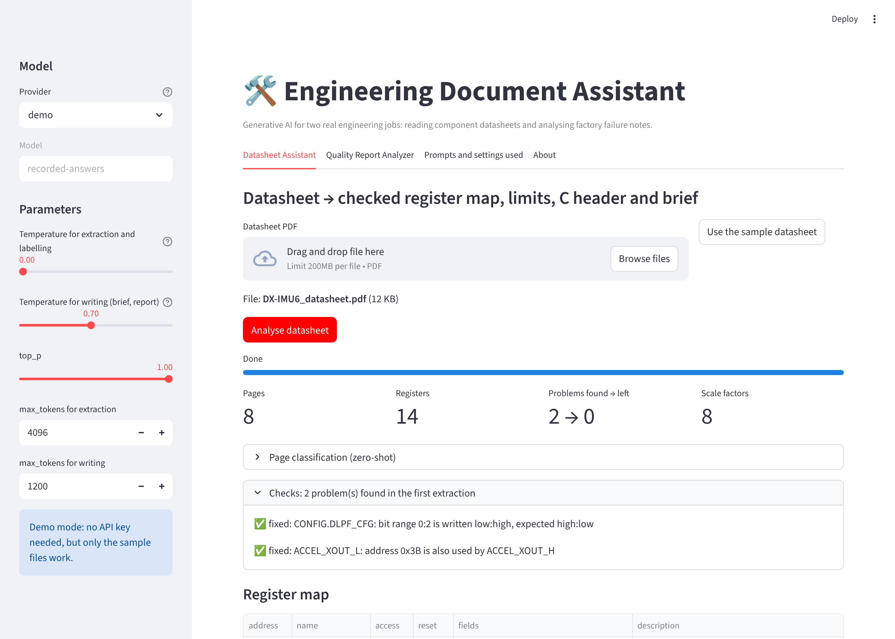
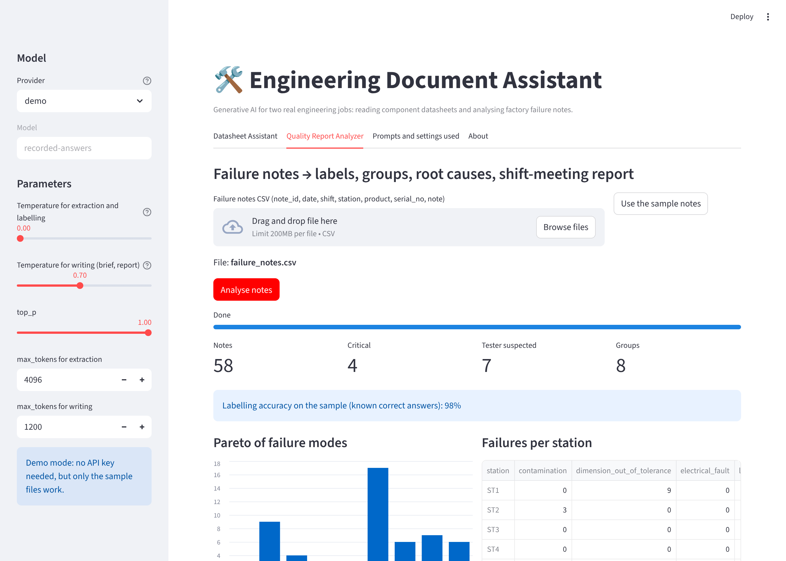
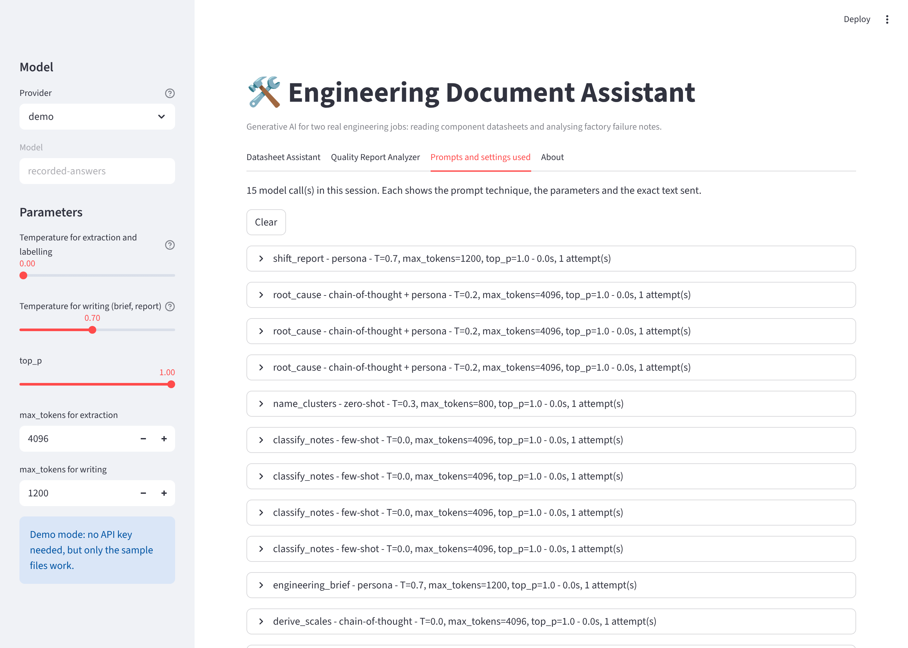

# Engineering Document Assistant

[](https://github.com/HannaBeshoy/genai-engineering-assistant/actions/workflows/ci.yml)

**Introduction to Generative AI course project (INBPA9962L)** · University of Debrecen, Faculty of Informatics · Python, LangChain, Streamlit, Groq / OpenAI / Ollama · **individual project, 44 tests in CI, demo mode runs without an API key**

A Streamlit application with two generative-AI tools for jobs that engineers really do:

1. **Datasheet Assistant**: reads a component datasheet PDF and produces a *checked* register map, the electrical limits, the sensor scale factors, a C header for the driver, a one-page engineering brief, and answers questions with page references.
2. **Quality Report Analyzer**: reads free-text failure notes from end-of-line test stations (CSV) and labels them, groups them, finds likely root causes, and writes the report for the morning shift meeting.

Both are pipelines of several model calls joined by ordinary code (validation, clustering, statistics, code generation), not a question-and-answer chat.

| Datasheet Assistant | Quality Report Analyzer | Prompts and settings used |
| --- | --- | --- |
|  |  |  |

## How it meets the grading criteria (grade 5)

| Criterion | Where |
| --- | --- |
| Functional application with a frontend | `app.py`: Streamlit, two tools, downloads, a page that shows every prompt sent |
| Use of an API | `assistant/llm.py`: Groq, OpenAI or Ollama through LangChain chat models (the course's stack and versions) |
| Solves a real-world problem, substantive processing | datasheet → validated JSON → C header; notes → labels → k-means groups → Pareto → root causes → report |
| Parameter tuning | temperature, top_p and max_tokens in the sidebar, chosen per step (0 for extraction, 0.7 for writing); `experiments/param_tuning.py` measures their effect |
| Prompt techniques (2 required) | **six**: zero-shot, few-shot, chain-of-thought, persona, retrieval-grounded answering, self-correction with validator feedback ([table](#prompt-techniques)) |
| Error handling | `assistant/errors.py`: bad or scanned PDFs, bad CSVs, missing or wrong API keys, rate limits (retry with exponential back-off), timeouts, provider offline, answers cut off by max_tokens, invalid JSON (repaired by the model, up to 2 times) |
| Documentation and GitHub | this repository, [docs/PROJECT_GUIDE.md](docs/PROJECT_GUIDE.md) |

## The two pipelines

```text
Datasheet PDF ─ pypdf (layout mode keeps table rows)
  1 classify_pages      zero-shot           which pages hold registers / limits
  2 extract_registers   few-shot, T=0       register map JSON, chunked for long datasheets
  3 extract_limits      few-shot, T=0       electrical limits JSON
  4 checks (code)                           duplicate addresses, overlapping or reversed bit fields, min<=typ<=max, units
  5 review_registers    persona + findings  "senior embedded engineer" fixes what the checks found, then re-check
  6 derive_scales       chain-of-thought    full-scale settings and LSB-per-unit sensitivities
  7 C header (code)                         #defines generated from the checked JSON, not by the model
  8 engineering_brief   persona, T=0.7      limits table, wiring checklist, start-up sequence, gotchas
  + ask_datasheet       TF-IDF retrieval of the 3 best pages, answers cite [p. N]

Failure notes CSV ─ pandas, column and value checks
  1 classify_notes      few-shot, batches of 15   failure mode, component, severity, tester suspected
  2 grouping (code)     TF-IDF + k-means, k chosen by silhouette score
  3 name_clusters       zero-shot                 a name and description per group
  4 statistics (code)   Pareto, per station / product / shift / day
  5 root_cause          chain-of-thought + persona (8D quality engineer) for the top 3 failure modes
  6 shift_report        persona, T=0.7            Markdown for the 6 a.m. meeting
```

Every model answer is validated against a pydantic schema (`assistant/schemas.py`). If it does not fit, the model gets its own answer back with the exact validation errors and is asked to correct it (`assistant/structured.py`).

## Prompt techniques

| Step | Technique | Why this technique |
| --- | --- | --- |
| classify_pages, name_clusters | zero-shot | simple, well-defined categories |
| extract_registers, extract_limits, classify_notes | few-shot | the examples fix the exact JSON format and labelling style |
| derive_scales, root_cause | chain-of-thought (answer in `<answer>` tags) | multi-step reasoning: find the field, list codes, compute 32768 / range, check consistency |
| review_registers, engineering_brief, root_cause, shift_report | persona | sets expertise, audience and tone |
| ask_datasheet | retrieval-grounded with citations | answers only from the retrieved pages, says "Not found" otherwise |
| *:repair | self-correction with validator feedback | turns invalid output into valid output without failing the run |

## Results on the sample files

The samples are made by `tools/make_samples.py`: a datasheet for a **fictional** 6-axis IMU (no copyrighted datasheet is included) and 58 synthetic failure notes, each with hand-checked correct answers.

| Check | Result (demo mode, recorded answers) |
| --- | --- |
| Register map, limits and scale factors vs. the correct answers | identical (14 registers, 9 limits, 8 scale factors) |
| Mistakes in the first extraction found by the checks → left after review | 2 → 0 (a duplicated address, a reversed bit range) |
| Note labelling accuracy | 98 % (57 of 58) |
| Top root cause found | noise on ST3 night shift, explained by under-greasing (13 of 17 noise notes, 3 of 3 lubrication notes) |

With a real model, run `python experiments/param_tuning.py --provider groq` to measure accuracy and repeatability for temperatures 0 to 1.2 and to see the truncation handling; it writes `experiments/results/param_tuning.md`.

## Running it

```bash
conda create --name genai python=3.10      # as in the course (lab 07)
conda activate genai
pip install -r requirements.txt
streamlit run app.py
```

Choose a provider in the sidebar:

| Provider | Key | Note |
| --- | --- | --- |
| demo | none | replays recorded answers; only the sample files work |
| groq | `GROQ_API_KEY` (free at console.groq.com, no card) | default model `llama-3.3-70b-versatile` |
| openai | `OPENAI_API_KEY` | default model `gpt-4o-mini` |
| ollama | none | local and offline: `ollama pull llama3.2`, then `ollama serve` |

Paste the key in the sidebar (kept only for the browser session) or copy `.env.example` to `.env`. Keys are never written to disk by the app and `.env` is in `.gitignore`.

Tests (no key or network needed):

```bash
pip install -r requirements-dev.txt
python -m pytest -q            # 44 tests: parsing, repair loop, retries, error mapping, PDF, checks, both pipelines, the app
ruff check .
```

## Repository layout

```text
app.py                    Streamlit front end
assistant/
  llm.py                  provider client: LangChain models, parameters, retries, error mapping, demo mode, call log
  structured.py           JSON extraction, pydantic validation, repair loop
  prompts.py              every prompt, with its technique
  schemas.py              the typed result of each step
  datasheet.py            tool 1 pipeline          quality.py   tool 2 pipeline
  pdf.py  checks.py  cheader.py  retrieval.py  errors.py
samples/                  fictional datasheet, synthetic notes, correct answers, recorded demo answers
tools/make_samples.py     rebuilds everything in samples/
experiments/param_tuning.py
tests/                    44 pytest tests, including a click-through of the app (Streamlit AppTest)
docs/PROJECT_GUIDE.md     design, defence notes, how to extend
```

## Author

Beshoy Hanna · Computer Science Engineering BSc, University of Debrecen · [GitHub](https://github.com/HannaBeshoy) · [LinkedIn](https://linkedin.com/in/beshoy-hanna-8b52213a0)
